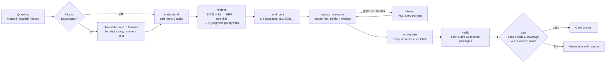
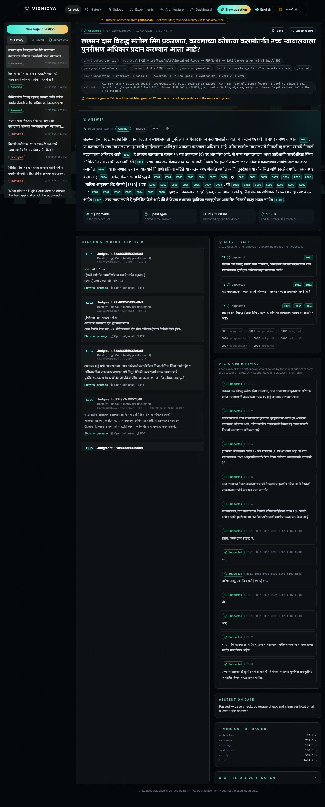
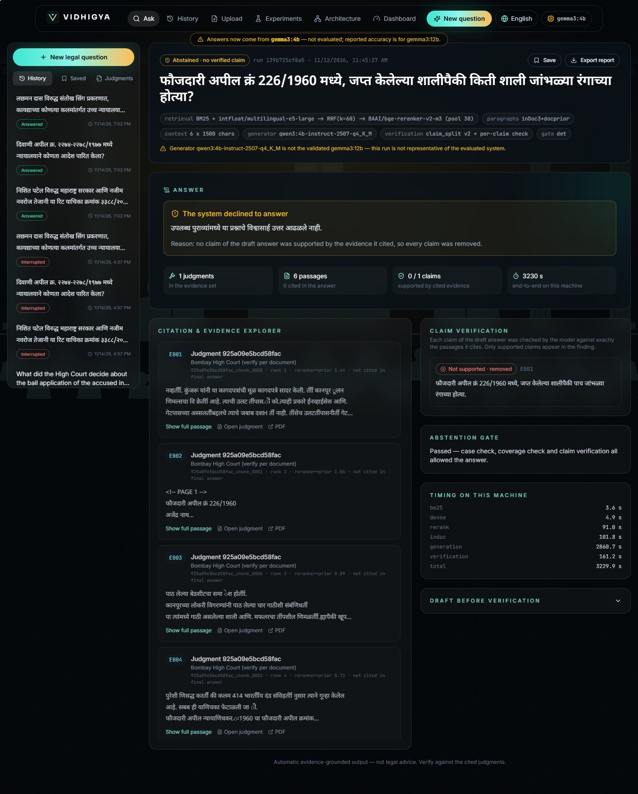
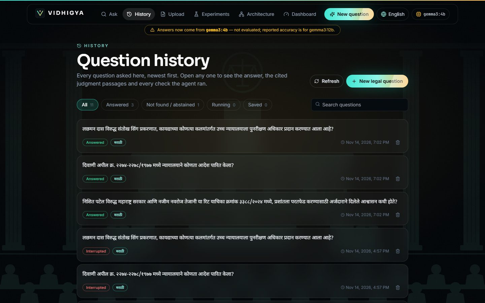
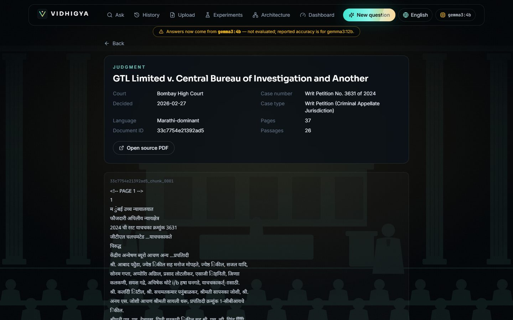
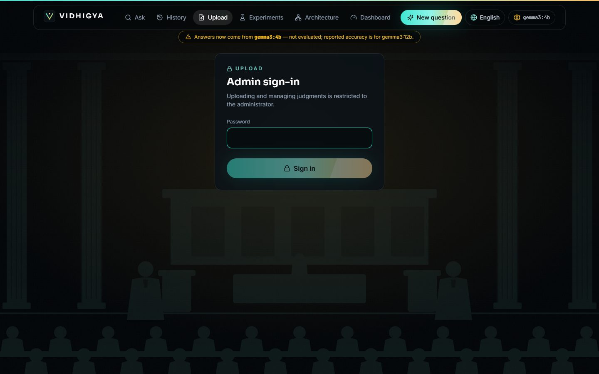
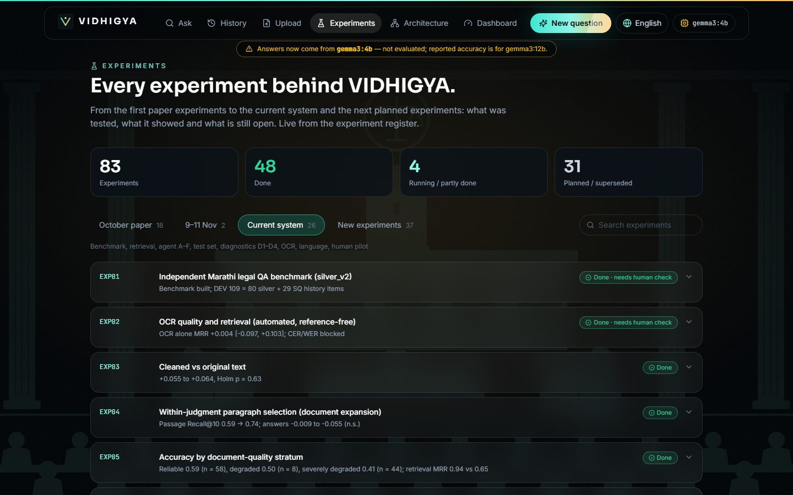
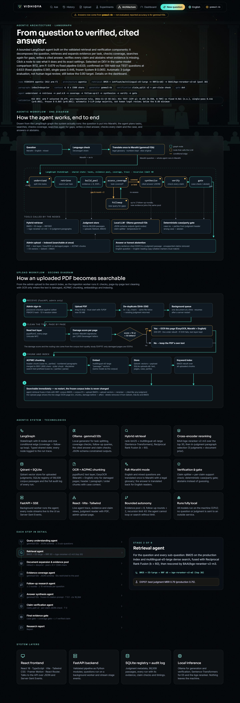
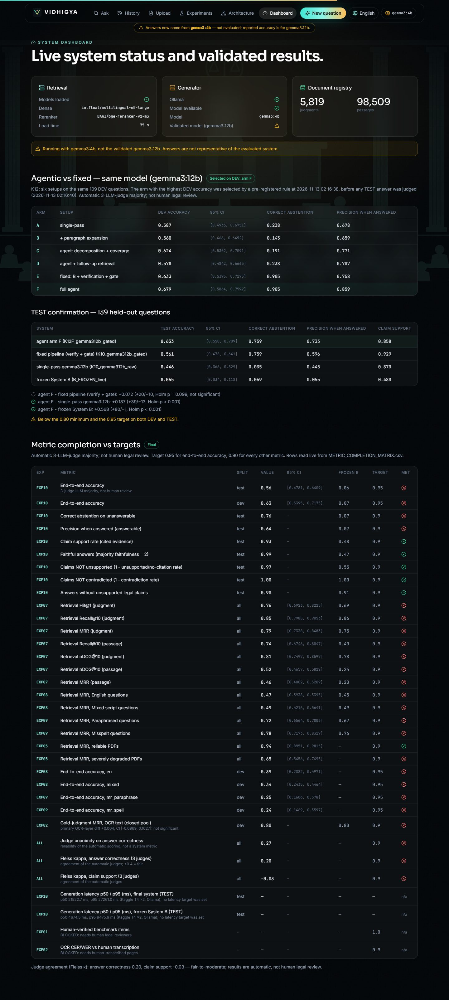

# VIDHIGYA — evidence-grounded legal research over Marathi court judgments

VIDHIGYA answers legal questions about Bombay High Court judgments published in Marathi. Every sentence of an answer cites the judgment passage it rests on, every claim is checked against that passage, and when the evidence does not support an answer the system says so instead of guessing.

> **Research prototype, not legal advice.** Every answer must be checked against the cited judgments. The Marathi judgments are translations, and the English originals are authoritative.


**Contents**
- [Why VIDHIGYA](#why-vidhigya)
- [What it does](#what-it-does)
- [Results](#results)
- [How it works](#how-it-works)
- [UI tour](#ui-tour)
- [Tech stack](#tech-stack)
- [Getting started](#getting-started)
- [Configuration](#configuration)
- [API](#api)
- [Repository layout](#repository-layout)
- [Limitations](#limitations)

## Why VIDHIGYA

Legal research in Marathi has four problems that a general chatbot does not solve:

1. **Language.** Marathi is spoken by more than 80 million people, but its judgments are hard to search. Users ask in Marathi, in English or in a mix of the two, with case numbers in either script (२०२४ or 2024).
2. **Damaged text.** The judgment PDFs embed fonts with broken character maps, so the extracted text loses or swaps letters: आणि becomes आचण, and याचिका becomes याचचका. Most of the 5,819 judgments in the corpus show this damage, and a correctly spelled query cannot match a misspelled judgment.
3. **Invented citations.** Studies of commercial legal AI tools found hallucinated or incorrect answers in roughly 17–33% of queries, even when the tools used retrieval. In law, an answer that cites the wrong judgment, or presents a party's allegation as the court's finding, does real harm.
4. **No honest refusal.** A system that always answers will answer questions about cases that do not exist.

VIDHIGYA treats **sufficient evidence as a precondition for answering**:
- **Cited and checked:** each claim must cite a passage, and a verifier removes claims the passage does not support.
- **Right case:** a deterministic check confirms that the evidence names the case the question asks about.
- **Honest refusal:** if any of these checks fails, it abstains and gives the reason.

## What it does

| Feature | How |
|---|---|
| **Ask in Marathi, English or a mix** | English and mixed questions are translated once into Marathi with a legal glossary, so the whole agent runs in the corpus language; numbers must survive the translation. |
| **Hybrid search** | BM25 and multilingual-E5 are fused with Reciprocal Rank Fusion. bge-reranker-v2-m3 then rescores the results, and the best paragraphs are selected inside the top judgments. |
| **Agentic research** | A bounded LangGraph agent splits the question into tasks, checks evidence coverage per task, and searches again for gaps. |
| **Cited answers** | Every sentence carries an evidence label (E001, E002, …) that opens the exact passage, the judgment and its PDF. |
| **Claim verification** | The draft answer is split into claims. Each claim is checked against only the passages it cites, and unsupported claims are removed. |
| **Fail-closed gate** | The system answers only if the case check passes, the coverage check passes and at least one claim is verified; otherwise it abstains with a coded reason. |
| **Upload new judgments** | An administrator uploads a PDF. Damaged pages are re-read with OCR, the judgment is chunked with ACPMC and indexed, and it becomes searchable at once without touching the frozen corpus index. |
| **Interface in three languages** | English, मराठी and हिंदी, switchable at any time. Answers can also be read translated. |
| **Choose the language model** | A menu lists the local Ollama models; the UI warns when the chosen model is not the validated gemma3:12b. |
| **Full audit trail** | Every run stores its plan, evidence, claim checks, gate decision and timings. You can save it, export it as a report or delete it. |
| **Runs fully local** | All models run on your machine through Ollama and Sentence-Transformers, so no question or document leaves the host. |

## Results

**Evaluation design:**
- **Selection:** the agent was chosen on 109 development questions by a rule fixed in advance.
- **Test:** it was then evaluated **once** on 139 locked test questions, drawn from judgments it had never seen. Of these, 29 ask about fictional cases that no judgment can answer.
- **Fairness:** every system used the same model (gemma3:12b).
- **Scoring:** correctness is the majority vote of three LLM judges, not a human legal review.

| System (locked test, n = 139) | Accuracy | 95% CI | Correct refusal (fictional cases) |
|---|---|---|---|
| **VIDHIGYA agent** | **0.633** | 0.550–0.709 | **0.759** |
| Fixed verification pipeline (same checks, no agent) | 0.561 | 0.478–0.641 | 0.759 |
| Single-pass RAG (same model) | 0.446 | 0.366–0.529 | 0.035 |
| Original system | 0.065 | 0.034–0.118 | 0.069 |

**What the numbers show:**
- **Against single-pass RAG and the original system:** the agent is significantly better (exact McNemar test, Holm-corrected p < 0.001).
- **Against the fixed pipeline:** the difference was not significant (p = 0.099).
- **What drives the gain:** an ablation on the development questions attributes most of it to claim verification and the deterministic gate. The gate alone raised correct refusals from 0.33 to 0.90 without lowering accuracy.
- **Claims:** none of the agent's 358 judged claims contradicted the evidence it cited.
- **Calibration:** a 20-item pilot with a practising advocate was stricter than the LLM judges, so read these accuracies as upper estimates.

The full study, including negative results, is in the accompanying research paper.

## How it works



| Node | What it does | Bound |
|---|---|---|
| `understand` | Splits the question into tasks under a JSON schema. A task that invents a number or loses the Marathi content is rejected, and the original question is used instead. | ≤ 3 tasks |
| `retrieve` | Runs BM25 and multilingual-E5-large (top 100 each), fuses them with RRF (k = 60), reranks the top 30 with bge-reranker-v2-m3, then selects paragraphs inside the top 3 judgments (judgment prior λ = 0.5). | — |
| `build_pool` | Interleaves the results of each task, removes duplicates and assigns stable evidence IDs. | ≤ 8 passages × 1,500 chars |
| `assess_coverage` | Asks whether each task is covered; the model may cite only IDs that are in the pool. | — |
| `followup` | Writes a new query for each uncovered task; new passages replace unsupported ones. | ≤ 2 rounds, ≤ 10 searches |
| `synthesize` | Writes the answer as JSON, with every sentence citing pooled evidence. | temperature 0.1 |
| `verify` | Splits the answer into claims and checks each against exactly the passages it cites; unsupported claims are removed. | temperature 0 |
| `gate` | A deterministic check that the case number or party names in the question appear in a cited judgment's header (digits normalised across scripts, names compared as consonant skeletons). It also requires coverage and at least one verified claim. | recursion limit 40 |

Every node streams its progress to the browser over Server-Sent Events. The full trace is stored with the answer.

## UI tour

The screenshots below are from a laptop run. The yellow banner appears because the generator in use there was **gemma3:4b**; the UI always flags a model other than the validated gemma3:12b, because the reported accuracy holds only for gemma3:12b.

### 1. Home — `/`


The landing page states what the system is and gives a single box for asking a question. The top bar, shown on every page, holds:
- **Navigation:** Ask, History, Upload, Experiments, Architecture and Dashboard.
- **New question:** starts a fresh question from anywhere.
- **Interface language:** English, मराठी or हिंदी.
- **LLM menu:** pick which local Ollama model generates answers.

### 2. Ask: a verified, cited answer — `/research/:id`



This is the research workspace. The answer page has five parts:
- **Left column:** the question history, saved runs, and a list of judgments.
- **Header:** the exact configuration used for this run (retriever, reranker, paragraph selection, context budget, generator, verification and gate), plus the validated results of that configuration.
- **Answer card:**
  - the answer, with clickable evidence labels;
  - a switch to read it in English, Marathi or Hindi (citation labels must survive the translation);
  - totals for judgments, passages, verified claims and time.
- **Citation & evidence explorer:** every passage the agent used, with its judgment, chunk ID and rank. Each passage has *Show full passage*, *Open judgment* and *PDF* links.
- **Right column:** the run's checks.
  - **Agent trace:** the sub-questions and the evidence that covered each one.
  - **Claim verification:** every claim with its verdict.
  - **Abstention gate:** the gate's decision.
  - **Timing per stage, and the draft before verification:** so you can see what the verifier removed.

### 3. Ask: an honest abstention



When no claim survives verification, or the evidence does not name the case asked about, VIDHIGYA declines. It states the reason in the question's language, and still shows the evidence it found and the claim that was removed. A refusal is a result, not a failure: it tells the user that the corpus did not support an answer.

### 4. History — `/history`



Every question asked, newest first:
- **Filters:** answered, not found / abstained, running, saved, plus full-text search.
- **Each row:** its status and language. Open it to see the full run, or delete it.

### 5. Judgment viewer — `/judgments/:id`



The source behind every citation:
- **Metadata:** case title, court, case number and type, decision date, language, pages and passages.
- **Original PDF:** opens with one click.
- **Indexed text:** every stored passage, so you can see exactly what the system read, including any extraction damage.

### 6. Upload — `/upload`



Upload is for administrators only. The password is stored only as a salted PBKDF2 hash, and sessions expire after 12 hours.

After signing in, an administrator drops a PDF (at most 50 MB). The page shows each ingestion stage live:
1. Duplicate check by SHA-256.
2. Damage score per page.
3. OCR of damaged pages with EasyOCR.
4. ACPMC chunking.
5. E5 embedding.
6. Storage in Qdrant and SQLite, and a BM25 rebuild.

The judgment is searchable as soon as it finishes, and a delete removes it from every index.

### 7. Experiments — `/experiments`



Every experiment behind VIDHIGYA, read live from the experiment register. The tabs cover the October paper, the 9–11 November series, the current system and the 37 proposed follow-up experiments. Each card shows:
- **What was tested** and the key result.
- **Status:** done, needs human check, running or planned.
- **When expanded:** the full method and the finding.

### 8. Architecture — `/architecture`



How the system is built, drawn from the code:
- **Agent diagram:** the LangGraph agent with the tool each node calls.
- **Upload diagram:** how an uploaded PDF becomes searchable.
- **Technology cards.**
- **Step explorer:** shows the exact settings and the experiment that chose each one.
- **The four system layers:** React frontend, FastAPI backend, SQLite registry, local inference.

### 9. Dashboard — `/dashboard`



Live system status, plus the validated results read from the result files (no number is typed into the UI):
- **Status:** the retrieval models loaded, the generator and whether it is the validated one, and the size of the document registry.
- **Development comparison:** six setups A–F on the 109 development questions.
- **Test confirmation:** the 139 locked test questions, with paired tests.
- **Metric matrix:** every metric against its target, each marked met or not met.

## Tech stack

| Layer | Technology |
|---|---|
| **Frontend** | React 18, TypeScript, Vite, Tailwind CSS, Framer Motion, React Router; Server-Sent Events for live runs |
| **Backend** | FastAPI and Uvicorn, with a background worker for agent runs and ingestion |
| **Agent** | LangGraph state graph with 8 nodes and 1 conditional edge |
| **Retrieval** | rank-bm25; Sentence-Transformers `intfloat/multilingual-e5-large`; `BAAI/bge-reranker-v2-m3` |
| **Generation and checks** | Ollama, `gemma3:12b` validated; any local model can be selected |
| **Storage** | SQLite (judgment registry, 98,509 passages, runs, claims, events); Qdrant for uploaded judgments |
| **Ingestion** | pypdfium2 text layer, EasyOCR (Marathi + English) for damaged pages, ACPMC chunking |

## Getting started

### Requirements

- **Software:** Python 3.11+, Node 20+, and Ollama (newer than 0.17.1) with `ollama pull gemma3:12b`.
- **Hardware:** a GPU with at least 12 GB for gemma3:12b. Without one, run Ollama on a GPU host and set `OLLAMA_URL`. On a 16 GB CPU-only laptop, set `LOW_MEMORY=1` and choose a smaller model in the LLM menu (answers are then flagged as not validated).
- **Runtime data:** in `data/`, which is not in git (about 3.4 GB). This is the corpus and its indexes:

  ```
  data/
    corpus/points.jsonl                  98,509 passages with judgment IDs
    corpus/vectors_e5large_clean.npy     E5 vectors of the passages
    corpus/judgments.jsonl               judgment metadata
    bm25_index_clean_v1/                 BM25 index
    pdfs/                                5,819 judgment PDFs
    results/                             evaluation result files shown on the Dashboard
    experiment_register/content.json     experiment register shown on the Experiments page
  ```
- **Models:** `models/multilingual-e5-large` and the bge-reranker in the Hugging Face cache. Both download automatically on first run if they are missing.

### Run

```bash
cd backend
pip install -r requirements.txt
python scripts/build_registry.py          # once: builds database/vidhigya.db from data/
python -m uvicorn app.main:app --port 8077
```

```bash
cd frontend
npm install
npm run build        # the backend then serves the UI at http://localhost:8077
# or: npm run dev    # http://localhost:5173, proxies /api to :8077
```

Set the upload password once with `python -m app.auth set`. Only a salted hash is stored.

To regenerate the README screenshots, start the backend and run `python docs/make_screenshots.py http://127.0.0.1:8077` (needs Playwright and Chrome).

## Configuration

Every setting in `backend/app/config.py` can be overridden with an environment variable of the same name. The most useful:

| Variable | Default | Purpose |
|---|---|---|
| `OLLAMA_URL` | `http://localhost:11434` | Ollama server, e.g. a GPU host |
| `GEN_MODEL` | `gemma3:12b` | Generator, overriding the UI choice |
| `LOW_MEMORY` | `0` | `1` frees the retrieval models before generation, for 16 GB machines |
| `QUERY_TRANSLATE` | `1` | Translate English and mixed questions to Marathi |
| `RERANK_POOL` | `30` | Fused candidates passed to the reranker |
| `OCR_THRESHOLD` | `10` | Damage signatures per 1,000 Devanagari letters that send an uploaded page to OCR |
| `MAX_UPLOAD_MB` | `50` | Upload size limit |
| `HF_HUB_OFFLINE` | unset | `1` skips Hugging Face network checks at start-up |

## API

| Method | Path | Purpose |
|---|---|---|
| GET | `/api/health` | Component status, loaded models, and whether the generator is the validated one |
| POST | `/api/research` | Start a research run (returns 202 and a run ID) |
| GET | `/api/research` | List runs |
| GET | `/api/research/{id}` | Full run: answer, evidence, claims, gate, timings |
| GET | `/api/research/{id}/events` | Live stage events (Server-Sent Events) |
| POST | `/api/research/{id}/save` | Save or unsave a run |
| POST | `/api/research/{id}/translate` | Read the answer in another language (citation labels checked) |
| GET | `/api/research/{id}/export` | Export the run as a text report |
| DELETE | `/api/research/{id}` | Delete a run |
| GET | `/api/judgments`, `/api/judgments/{doc}`, `/api/judgments/{doc}/pdf` | Judgment list, metadata and passages, source PDF |
| GET | `/api/models`, POST `/api/models/select` | List local models and choose the generator |
| POST | `/api/uploads/login`, `/api/uploads/logout` | Administrator session |
| POST, GET, DELETE | `/api/uploads`, `/api/uploads/{doc}` | Upload, list, inspect or remove a judgment (administrator only) |
| GET | `/api/experiments`, `/api/evaluation` | Experiment register and validated results |

## Repository layout

```
backend/
  app/            FastAPI app: agent (vidhigya_agent.py), retrieval, generation, verification,
                  ingestion (ingest.py, chunking.py), translation (qtranslate.py), auth, config
  app/frozen/     the original system, frozen and checksummed, kept as a baseline
  scripts/        build_registry.py
frontend/
  src/pages/      Landing, Workspace (Ask), History, Upload, Experiments, Architecture, Dashboard, JudgmentPage
  src/components/ agent trace, workflow diagram, run view, language switch, shell
docs/
  screenshots/    the images in this README
  make_screenshots.py
  TESTING.md      testing record of the production build
FINAL_SELECTED_ARCHITECTURE.md       which configuration was selected, and why
VIDHIGYA_FINAL_TECHNICAL_ARCHITECTURE.md
CONFIG_FREEZE_*.json                 frozen configurations used for the reported runs
```

## Limitations

- **Automatic evaluation.** Accuracy comes from three LLM judges and a 20-item advocate pilot, not from a full human legal review.
- **Silver benchmark.** Questions and reference answers were written and checked by language models, not legal experts.
- **Unanswerable questions are fictional cases.** Realistic unanswerable questions about real cases would be harder.
- **English and mixed questions are weaker than Marathi** (development accuracy 0.525 and 0.425, against 0.675 for Marathi).
- **Cleaner text improved retrieval but not answers.** The deployed index keeps the original text layer.
- **The answers are below the accuracy that legal practice would require.**

No license has been chosen yet, so all rights are reserved by the authors.
