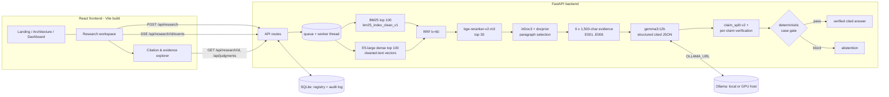

# VIDHIGYA — Final Technical Architecture (what was actually built)

Folder: `C:\Users\mitul jain\Downloads\code\VIDHIGYA_AI_PROD` (frontend, backend, database, models, docs, screenshots).
Originals are untouched: `NYAYA_AI_PRODUCTION/` (previous app, kept as backup) and `VIDHIGYA_Q1_COMPLETE_RESEARCH/` are only
read. Selection rationale and evidence: `FINAL_SELECTED_ARCHITECTURE.md`.

## A. Frontend
| Item | Choice |
|---|---|
| Framework | React 18.3.1 + TypeScript 5.6.3 (strict), built with Vite 5.4.11 |
| Styling | Tailwind CSS 3.4.15 (custom dark theme tokens: ink / electric / violet), PostCSS + Autoprefixer |
| Animation | Framer Motion 11.11.17 (page transitions, scroll reveals, live pipeline); a lightweight 2D-canvas neural field (no Three.js — a 3D scene would add ~600 KB without improving the research workflow) |
| Icons | lucide-react 0.460.0 |
| Routing | React Router 6.28.0 — `/`, `/research`, `/research/:runId`, `/architecture`, `/dashboard`, `/judgments/:docId` |
| State | component state + typed API client (`src/api.ts`); no global store needed |
| Fonts | Sora (display), Inter (UI), Noto Sans Devanagari (Marathi), JetBrains Mono |
| Bundle | 363 KB JS / 114 KB gzipped, 28 KB CSS |

Components: `Shell` (header, nav, page transitions) · `NeuralField` (animated network, pauses off-screen, respects reduced motion) ·
`PipelineViz` (interactive 10-stage architecture; also drives the live run timeline) · `RunView` (research report, citation &
evidence explorer, claim verification, gate, timings, draft) · pages `Landing`, `Workspace`, `Architecture`, `Dashboard`, `JudgmentPage`.
`src/pipeline.ts` holds the stage definitions; their ids equal the backend's run-event stages.

## B. Backend
| Item | Choice |
|---|---|
| Framework | FastAPI (retained — the existing production app is FastAPI) + Uvicorn |
| Database | SQLite `database/vidhigya.db`: `judgments` (5,819 unique), `chunks` (98,509; `vec_row` = row in the E5 vector file), and the audit log `research_runs`, `run_evidence`, `run_claims`, `run_events` |
| Document registry | built by `backend/scripts/build_registry.py` from the research corpus (`points.jsonl`) and `judgments.jsonl` metadata |
| Execution | research runs are queued and executed one at a time on a background worker thread; every stage is written to `run_events` and streamed to the browser with Server-Sent Events |
| Frozen code reused | `app/frozen/structured_citations.py`, `app/frozen/prompt.py` (frozen-B `build_prompt`, verbatim), `app/frozen/text_utils.py` (production BM25 tokeniser); SHA-256 in `app/frozen/SOURCES_SHA256.txt` |

### API
| Method | Path | Purpose |
|---|---|---|
| GET | `/api/health` | component status, loaded models, registry size, active configuration, whether the validated generator is in use |
| POST | `/api/research` `{question}` | queue a research run → `{run_id}` (202) |
| GET | `/api/research?saved=` | research history / saved research |
| GET | `/api/research/{id}` | full report: answer, citations, evidence with judgment metadata, claim reviews, gate, timings, events |
| GET | `/api/research/{id}/events` | live stage events (SSE) |
| POST | `/api/research/{id}/save?saved=` | save / unsave |
| GET | `/api/research/{id}/export` | Markdown research report |
| GET | `/api/judgments?q=` · `/api/judgments/{doc}` · `/api/judgments/{doc}/pdf` | judgment search, full text by passage, source PDF |
| GET | `/api/evaluation` | research results read live from the result files (final or provisional) |

## C. Selected AI architecture (implemented in `app/retrieval.py`, `app/generation.py`, `app/pipeline.py`)
| Stage | Implementation |
|---|---|
| System | improved System B, K10a configuration (selected on DEV) |
| Query processing | Unicode NFC + whitespace collapse |
| BM25 | production `bm25_index_clean_v1` (BM25Okapi k1 1.5, b 0.75), production tokeniser, top 100 |
| Embedding | `intfloat/multilingual-e5-large`, `query: ` prefix, normalised; corpus vectors over cleaned text (K04), exact cosine search, top 100 |
| Fusion | RRF k = 60, keep 100 (same code as EXP07) |
| Reranker | `BAAI/bge-reranker-v2-m3`, max_length 512, fused top 30 rescored |
| Paragraph selection | inDoc3 + docprior: all chunks of the top 3 judgments rescored (first 2,000 chars), + 0.5 / judgment rank (EXP07b) |
| Context | top 6 passages × 1,500 chars, stable evidence IDs E001… (frozen `assign_evidence_ids`) |
| LLM | `gemma3:12b` via Ollama; JSON-schema structured output, T 0.1, num_ctx 16,384, num_predict 1,024, seed 20261111 |
| Claim verification | claim_split v2; each claim checked by the same model against exactly its cited passages (T 0, JSON boolean); unsupported claims removed |
| Citation validation | frozen `parse_structured_response`: schema-valid JSON, citations restricted to supplied IDs |
| Abstention | (1) nothing verified → abstain; (2) deterministic case gate: case number or "X विरुद्ध Y" parties not in any retrieved judgment's first two chunks → abstain |
Configurable by environment variable (defaults = selected): `GEN_MODEL`, `OLLAMA_URL`, `RANK_MODE` (indoc|plain), `TOP_N`,
`PASSAGE_CHARS`, `NUM_CTX`, `VERIFY`, `GATE`, `DEVICE`, data paths. The UI flags any run whose generator is not gemma3:12b.

## D. Architecture diagram

## E. Experimental justification (summary — details in FINAL_SELECTED_ARCHITECTURE.md)
DEV (109 questions): selected configuration 0.615 [0.521, 0.701] end-to-end accuracy vs 0.073 [0.038, 0.138] for frozen System B;
correct abstention 0.857 vs 0.048; unsupported-claim rate 0.013 vs 0.315. Retrieval (EXP07): judgment MRR 0.794 vs 0.752,
passage Recall@10 0.740 vs 0.396. Rejected: qwen2.5:7b generator (0.413), LLM gate (0.284, over-abstains), production
ranking (lower retrieval), OCR substitution (null primary result). TEST (139 questions): pending final judge majority — to be added
without changing the selection.

## F. Implementation
Created (all new, under `VIDHIGYA_AI_PROD/`): `backend/app/{config,retrieval,generation,pipeline,main}.py`, `backend/app/schema.sql`,
`backend/app/frozen/*` (copies), `backend/scripts/build_registry.py`, `backend/requirements.txt`, `frontend/` (Vite project:
`index.html`, configs, `src/main.tsx`, `src/api.ts`, `src/pipeline.ts`, `src/index.css`, `src/components/{Shell,NeuralField,PipelineViz,RunView}.tsx`,
`src/pages/{Landing,Workspace,Architecture,Dashboard,JudgmentPage}.tsx`), `database/vidhigya.db`, `models/multilingual-e5-large/`,
`FINAL_SELECTED_ARCHITECTURE.md`, this file, `README.md`, `VIDHIGYA_UI_SCREENSHOTS/`. Modified outside the folder: none
(only `Downloads/code/.claude/launch.json` for the preview pane).

Environment variables: see section C; plus `CORS_ORIGINS`, `PRELOAD` (load models at start-up, default 1), `HF_HUB_OFFLINE=1` (recommended, avoids network checks).

Run (development): `cd backend && python -m uvicorn app.main:app --port 8077` and `cd frontend && npm run dev` → http://localhost:5173.
Run (single server): `cd frontend && npm run build`, then the backend serves the built UI at http://localhost:8077.
Deployment: keep the backend + SQLite on the private machine (judgments never leave it); point `OLLAMA_URL` at a GPU host running
Ollama with `gemma3:12b` (≥ 12 GB VRAM). A 16 GB CPU-only laptop cannot hold gemma3:12b and the retrieval models together.

## G. Testing
See the testing section of README.md (updated after each test session).
